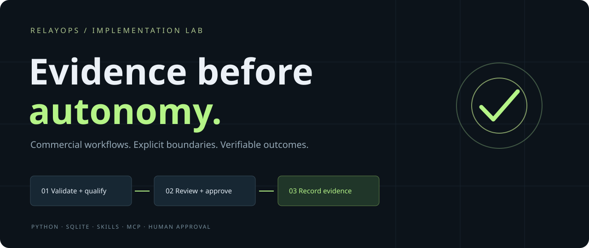
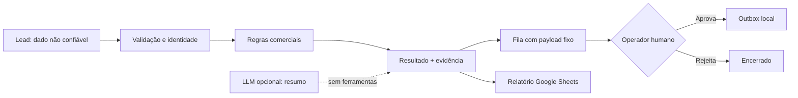

<div align="center">

# ↗ RelayOps
### Evidence before autonomy.

**Um processo comercial completo. Um agente com limites explícitos. Uma entrega verificável.**

Python · SQLite · Agent Skills · MCP · Google Sheets · Human-in-the-loop

[Começar](#execute-em-2-minutos) · [Arquitetura](docs/architecture.md) · [Evidências](docs/evidence.md) · [Handoff](docs/handoff.md) · [English](docs/README.en.md)

</div>

---

## O problema de negócio

Leads chegam por diferentes canais, informações ficam incompletas e o comercial repete tarefas sem uma trilha clara de decisões. Colocar um chatbot nessa operação não resolve identidade, consentimento, integração e responsabilidade por ações.

Desenvolvi o RelayOps para demonstrar como transformo um processo comercial em um fluxo executável com agentes de IA: **kickoff → processo → skill → execução → aprovação → evidência → handoff**. Escolhi uma campanha imobiliária como cenário pela minha experiência no setor e usei dados fictícios para permitir uma avaliação pública e reproduzível, sem expor clientes.

## Execute em 2 minutos

Requer Python 3.9+ para o núcleo, sem dependências externas. Execute na raiz do repositório clonado:

```bash
python3 -m relayops demo
python3 -m relayops serve
```

Abra **http://127.0.0.1:8765**. Inspecione os seis cenários, aprove um rascunho e execute novamente a demonstração: nada é duplicado. A aprovação libera uma **outbox local**; nenhum e-mail é enviado.

```bash
python3 -m unittest discover -s tests -v
python3 -m relayops report
```

Para uma demonstração isolada, use `python3 -m relayops --db runtime/segunda-demo.db serve`. O banco é criado quando necessário. O servidor escuta somente no loopback.

## Novo: agente orientado por objetivo

Além da demo offline, há um loop com modelo local que lê uma planilha, interpreta mensagens, escolhe ferramentas permitidas, registra avaliações e confere cada gravação antes de concluir. O processo inclui um caso de orçamento conflitante e um texto tentando alterar as instruções do agente.

**Validado em execução real:** três revisões gravadas e conferidas no Google Sheets, com modelo local, 9 ações de ferramenta e 41 testes automatizados. Veja o [registro e as limitações da validação](docs/evidence.md).

Veja [execução com Ollama e Google Sheets](docs/goal-agent.md). O pacote inclui uma planilha sintética pronta para importação, execução direta com OAuth e uma ponte explícita para conectores autenticados no anfitrião.

## O que está implementado

| Etapa | Evidência observável |
|---|---|
| Entrada e validação | Schema estrito, consentimento booleano e tipos conferidos |
| Qualificação | Critérios explícitos de orçamento e prazo, informação ausente reconhecida |
| Identidade | Deduplicação por e-mail e idempotência persistente por ID e hash |
| Aprovação | Destinatário e texto fixos; decisões finais e liberação única |
| Auditoria | Eventos encadeados por hash, verificação de alterações |
| Operação | Painel local, CLI, persistência SQLite, reinício sem duplicar ações |
| Skills | Procedimentos de negócio, perfil e referências sob demanda |
| Integrações | Adaptador Sheets com RAW e leitura de conferência; MCP stdio opcional |
| LLM | Advisor consultivo e operador por objetivo com ferramentas de revisão limitadas |

**A demo padrão é determinística e não chama um LLM.** Isso permite testar o contrato de execução sem chaves nem custo de API. O advisor opcional resume contexto sem ferramentas. No novo modo conectado, o operador LLM escolhe ações de revisão dentro das permissões verificadas pelo runtime. Ambos mantêm o escopo comercial limitado.

## Seis cenários de validação

| Entrada sintética | Resultado esperado |
|---|---|
| Orçamento e prazo compatíveis | `sales_ready` |
| Orçamento ausente | `needs_information` |
| Prazo fora da campanha | `nurture` |
| Mesmo e-mail em outro canal | `duplicate` |
| Sem permissão de contato | `no_contact`, sem rascunho |
| Texto pedindo para ignorar instruções | Nenhuma autoridade extra; permanece sob as regras |

As informações são fictícias e os e-mails usam `example.invalid`. Os tempos do painel medem apenas o trecho de processamento do núcleo, **não** latência de LLM, transação completa ou economia operacional.

## Modelo de autonomia



A exportação Sheets só ocorre por comando explícito com `--confirm-write`. O servidor MCP expõe inspeção e qualificação, **não** aprovação. A CLI e o painel são interfaces do operador local; não oferecem autenticação corporativa.

## Integrações opcionais

### Google Sheets

Crie uma planilha de teste com aba `RelayOps`. Obtenha um access token OAuth válido por sua infraestrutura de autenticação e configure `SHEETS_ID` e `GOOGLE_ACCESS_TOKEN` no ambiente local, sem compartilhar o token em conversas ou no Git.

```bash
python3 -m relayops export-sheets --confirm-write
```

O adaptador sobrescreve `RelayOps!A1:Dn` com o relatório atual e lê o mesmo intervalo para verificar. Não remove linhas antigas além desse intervalo. Não implementa login OAuth, refresh automático ou retentativas cegas. Detalhes em [integrações](docs/integrations.md).

### MCP stdio — Python 3.10+

```bash
python3 -m venv .venv
.venv/bin/pip install -r requirements-mcp.lock
.venv/bin/python -m relayops.mcp_server
```

Configure seu cliente MCP para executar esse comando **com a raiz deste repositório como diretório de trabalho**. Não há transporte remoto ou ferramenta de envio.

### Advisor local com Ollama

Com Ollama e um modelo já instalado:

```bash
python3 -m relayops advise --model SEU_MODELO_LOCAL
```

O advisor envia o lead sintético para o endpoint local `/api/chat`. Carrega perfil e skill de qualificação; a skill de handoff é um procedimento reutilizável para o agente anfitrião. Saída do modelo é não confiável e não altera o banco. A medição retorna tokens informados pelo provedor; custo de infraestrutura local não é medido.

## Para quem está avaliando este projeto

1. Rode os testes e a demo.
2. Abra `relayops/core.py`: a aprovação está no código, não somente no prompt.
3. Compare `skills/` com os critérios e testes.
4. Aprove e rejeite rascunhos, reinicie a aplicação e confira a persistência.
5. Leia [decisões técnicas](docs/decisions.md), [limites de segurança](SECURITY.md) e [roteiro de apresentação](docs/demo-script.md).

## Como desenvolvi o projeto

Meu ponto de partida foi o processo comercial: quais informações o time precisa, o que o agente pode executar e quando uma decisão deve voltar para uma pessoa. A partir desse escopo, estruturei o RelayOps com ferramentas de execução delimitadas, critérios de qualificação e conferência dos registros gravados.

Usei o Codex na implementação do código, na construção dos testes e na documentação. O repositório reúne o resultado desse desenvolvimento assistido: arquitetura, regras de negócio, integrações, testes e evidências de execução. No [roteiro de apresentação](docs/demo-script.md), explico as decisões técnicas e como conferir o funcionamento do fluxo.

Na validação com Ollama e Google Sheets, o agente revisou três leads, registrou as avaliações e conferiu cada gravação. Incluí um orçamento conflitante e uma tentativa de alterar as instruções pelo conteúdo do lead para testar os limites do fluxo. Os resultados e as limitações observadas estão nas [evidências](docs/evidence.md).

## Como pretendo evoluir o RelayOps

Construí o RelayOps como uma base evolutiva para agentes aplicados a processos de negócio. Comecei pelo comercial, onde minha experiência ajuda a traduzir a rotina da equipe em critérios de qualificação, pontos de aprovação e ações verificáveis. Já validei a execução com modelo local e Google Sheets; o projeto também inclui um servidor MCP stdio com ferramentas delimitadas.

Minha proposta de evolução parte do processo do cliente: mapear a operação com o responsável da área, definir o escopo e o teto de autonomia do agente e conectar as ferramentas necessárias via MCP ou APIs. A partir dessa base, pretendo ampliar as integrações com CRM e outros sistemas, criar skills reutilizáveis e validar cada novo conector com uma tarefa real antes de ampliar a autonomia.

Para cada implantação, quero acompanhar qualidade das execuções, adoção e custo por tarefa, além de documentar e treinar a equipe para operar o agente. Essa é a direção do projeto: transformar uma execução demonstrável em uma operação que o cliente consiga acompanhar, manter e evoluir. As novas integrações e a operação com clientes são etapas futuras, distintas do fluxo já validado neste repositório.

## O que você pode acessar

Disponibilizei o código-fonte, os testes, os perfis e skills dos agentes, a documentação e as evidências com dados fictícios. Você pode clonar o repositório e executar a demonstração localmente, conforme a licença [MIT](LICENSE).

A interface roda no computador de quem executa o projeto; este repositório não hospeda uma aplicação pública. Contas, credenciais, modelos locais e dados de execução privados não fazem parte dos arquivos publicados. Para executar integrações na sua própria instalação, configure seus acessos conforme a [documentação](docs/goal-agent.md).

## Próximos passos para produção

A versão atual foi construída para execução local, com um único usuário. Para levá-la a uma operação com clientes, minha próxima etapa seria implementar autenticação e permissões por função, isolamento por cliente, gestão de segredos e ciclo de credenciais, retenção de dados e telemetria. Depois, validar adoção e qualidade com usuários reais. Detalho os limites atuais em [Segurança](SECURITY.md).
