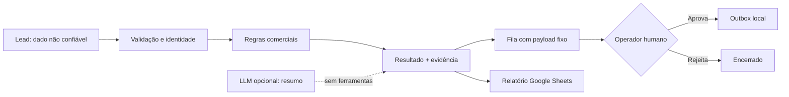

<div align="center">

# ↗ RelayOps
### Evidence before autonomy.

**Um processo comercial completo. Um agente com limites explícitos. Uma entrega verificável.**

Python · SQLite · Agent Skills · MCP · Google Sheets · Human-in-the-loop

[Começar](#execute-em-2-minutos) · [Arquitetura](docs/architecture.md) · [Evidências](docs/evidence.md) · [Handoff](docs/handoff.md) · [English](docs/README.en.md)

</div>

---

## O problema de negócio

Leads chegam por diferentes canais, informações ficam incompletas e o comercial repete tarefas sem uma trilha clara de decisões. Colocar um chatbot nessa operação não resolve identidade, consentimento, integração e responsabilidade por ações.

RelayOps demonstra o caminho **kickoff → processo → skill → execução → aprovação → evidência → handoff**, usando uma campanha imobiliária fictícia. É um projeto de portfólio desenvolvido por Kennedy Batis com assistência de agentes de código, não um sistema implantado na UPX ou um caso de produção de cliente.

## Execute em 2 minutos

Requer Python 3.9+ para o núcleo, sem dependências externas. Execute na raiz do repositório clonado:

```bash
python3 -m relayops demo
python3 -m relayops serve
```

Abra **http://127.0.0.1:8765**. Inspecione os seis cenários, aprove um rascunho e execute novamente a demonstração: nada é duplicado. A aprovação libera uma **outbox local**; nenhum e-mail é enviado.

```bash
python3 -m unittest discover -s tests -v
python3 -m relayops report
```

Para uma demonstração isolada, use `python3 -m relayops --db runtime/segunda-demo.db serve`. O banco é criado quando necessário. O servidor escuta somente no loopback.

## O que está implementado

| Etapa | Evidência observável |
|---|---|
| Entrada e validação | Schema estrito, consentimento booleano e tipos conferidos |
| Qualificação | Critérios explícitos de orçamento e prazo, informação ausente reconhecida |
| Identidade | Deduplicação por e-mail e idempotência persistente por ID e hash |
| Aprovação | Destinatário e texto fixos; decisões finais e liberação única |
| Auditoria | Eventos encadeados por hash, verificação de alterações |
| Operação | Painel local, CLI, persistência SQLite, reinício sem duplicar ações |
| Skills | Procedimentos de negócio, perfil e referências sob demanda |
| Integrações | Adaptador Sheets com RAW e leitura de conferência; MCP stdio opcional |
| LLM | Advisor Ollama opcional, resposta validada e sem acesso a ferramentas |

**A demo padrão é determinística e não chama um LLM.** Isso permite testar o contrato de execução sem chaves nem custo de API. O modelo opcional resume contexto e sugere perguntas; nunca altera permissões ou a classificação oficial. Não é um framework de agente autônomo de propósito geral.

## Seis cenários de validação

| Entrada sintética | Resultado esperado |
|---|---|
| Orçamento e prazo compatíveis | `sales_ready` |
| Orçamento ausente | `needs_information` |
| Prazo fora da campanha | `nurture` |
| Mesmo e-mail em outro canal | `duplicate` |
| Sem permissão de contato | `no_contact`, sem rascunho |
| Texto pedindo para ignorar instruções | Nenhuma autoridade extra; permanece sob as regras |

As informações são fictícias e os e-mails usam `example.invalid`. Os tempos do painel medem apenas o trecho de processamento do núcleo, **não** latência de LLM, transação completa ou economia operacional.

## Modelo de autonomia



A exportação Sheets só ocorre por comando explícito com `--confirm-write`. O servidor MCP expõe inspeção e qualificação, **não** aprovação. A CLI e o painel são interfaces do operador local; não oferecem autenticação corporativa.

## Integrações opcionais

### Google Sheets

Crie uma planilha de teste com aba `RelayOps`. Obtenha um access token OAuth válido por sua infraestrutura de autenticação e configure `SHEETS_ID` e `GOOGLE_ACCESS_TOKEN` no ambiente local, sem compartilhar o token em conversas ou no Git.

```bash
python3 -m relayops export-sheets --confirm-write
```

O adaptador sobrescreve `RelayOps!A1:Dn` com o relatório atual e lê o mesmo intervalo para verificar. Não remove linhas antigas além desse intervalo. Não implementa login OAuth, refresh automático ou retentativas cegas. Detalhes em [integrações](docs/integrations.md).

### MCP stdio — Python 3.10+

```bash
python3 -m venv .venv
.venv/bin/pip install -r requirements-mcp.lock
.venv/bin/python -m relayops.mcp_server
```

Configure seu cliente MCP para executar esse comando **com a raiz deste repositório como diretório de trabalho**. Não há transporte remoto ou ferramenta de envio.

### Advisor local com Ollama

Com Ollama e um modelo já instalado:

```bash
python3 -m relayops advise --model SEU_MODELO_LOCAL
```

O advisor envia o lead sintético para o endpoint local `/api/chat`. Carrega perfil e skill de qualificação; a skill de handoff é um procedimento reutilizável para o agente anfitrião. Saída do modelo é não confiável e não altera o banco. A medição retorna tokens informados pelo provedor; custo de infraestrutura local não é medido.

## Para quem está avaliando este projeto

1. Rode os testes e a demo.
2. Abra `relayops/core.py`: a aprovação está no código, não somente no prompt.
3. Compare `skills/` com os critérios e testes.
4. Aprove e rejeite rascunhos, reinicie a aplicação e confira a persistência.
5. Leia [decisões técnicas](docs/decisions.md), [limites de segurança](SECURITY.md) e [roteiro de apresentação](docs/demo-script.md).

## Transparência de construção

Kennedy definiu a intenção de negócio e o contexto comercial; o código, os testes e a documentação deste demonstrador foram produzidos com assistência do Codex. O roteiro de apresentação acompanha as decisões técnicas e a validação do fluxo. Não atribuímos resultados reais de clientes ou tempo de produção a este projeto.

**Status:** referência demonstrável, local e de usuário único. Para produção faltam autenticação/RBAC, segregação por cliente, gestão de segredos, política de retenção, operação de credenciais, telemetria e validação com usuários reais. Não há SLA, certificação, vínculo com UPX nem promessa de retorno.

Licença [MIT](LICENSE).
