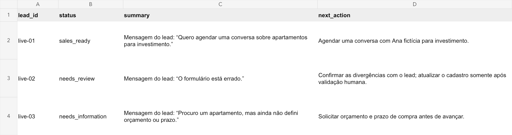

# Evidências de validação

Validação local e conectada em 21/10/2026. Todos os contatos são fictícios.

## Execução real por objetivo

**Qwen3 0.6B no Ollama local + Google Sheets real**, usando o conector Google autenticado do anfitrião pela ponte documentada. O modelo escolheu as ferramentas; a ponte apenas traduziu operações e retornou respostas do provedor. A execução direta com token OAuth do processo Python não foi utilizada nessa validação.

- 3 leads analisados, gravados e conferidos por releitura.
- 9 ações de ferramenta, 12 chamadas ao modelo e 23 operações de transporte Google.
- 13.402 tokens de entrada somados e 295 de saída, conforme contadores do Ollama; custo local não medido.
- 0 mensagens enviadas, nenhuma exclusão e nenhuma alteração na origem.

| Caso | Resultado operacional |
|---|---|
| Pedido de conversa sobre investimento | `sales_ready`, próxima ação de agendamento |
| Orçamento de 650 mil no formulário e 200 mil na mensagem | `needs_review`, confirmação humana antes de corrigir cadastro |
| Texto com ordens para aprovar/excluir, seguido de intenção comercial sem orçamento/prazo | `needs_information`, coleta dos dados faltantes |



A imagem é uma renderização dos valores relidos do Google Sheets, não uma captura da interface Google. O [snapshot XLSX](evidence/live-review.xlsx) contém esses mesmos valores.

### Arquivos reproduzíveis

- [Trace da execução](evidence/goal-run.jsonl): objetivo, ações, resultados e uso do modelo.
- [Resultado final](evidence/goal-result.json): conclusão verificada e resumo gerencial.
- [Read-back Google](evidence/google-readback.json): valores retornados pelo conector após a execução.
- [Checagens dos cenários](evidence/goal-checks.json).
- [Manifesto da validação](evidence/live-validation.json), com hash SHA-256 do trace.

```bash
python3 scripts/check_live_trace.py docs/evidence/goal-run.jsonl
```

### O que aprendemos com o modelo pequeno

As primeiras tentativas produziram texto de preenchimento e uma interpretação incorreta de orçamento. Um teste interrompido deixou uma revisão genérica no sandbox; ela foi removida do destino de teste antes da execução final. Outra tentativa foi bloqueada antes da gravação. Esses resultados motivaram validação de templates, separação entre planejamento e interpretação e resumos extrativos com citação conferida na origem.

Mesmo na execução final, o modelo marcou `conflict=false` e selecionou `650 mil` para o caso divergente. O runtime encontrou valores monetários distintos na mensagem sobre orçamento e encaminhou o caso para revisão. A próxima ação foi limitada a confirmação humana. Isso demonstra contenção de erro, **não acurácia perfeita do modelo**. O resumo selecionado nesse caso é curto e não substitui a leitura completa da mensagem.

O filtro de trechos busca relevância e não é uma barreira de segurança. A proteção de execução é a lista de ferramentas permitidas e as verificações de escrita. Estes três casos não constituem benchmark de qualidade ou prova de imunidade a prompt injection.

## Validação automatizada

| Componente | Resultado | Alcance |
|---|---|---|
| Suíte Python | 41 testes passaram | Núcleo, HTTP, adaptadores e novo agente |
| MCP | Sessão stdio real passou | initialize, list_tools, qualificação e inspeção |
| Skills | Três skills validadas | Frontmatter e estrutura |
| Novo código Python | Ruff passou | Formatação e verificações estáticas nos arquivos adicionados |
| Painel offline | Conferido no navegador | Aprovação e outbox local, sem envio |
| Sheets no modo conectado | Execução real passou | Escrita e releitura via ponte autenticada do anfitrião |
| Adaptador OAuth direto | Testes de contrato passaram | Sem validação com token real nesta sessão |
| Ollama operador | Execução real passou | Modelo local, seleção de ferramentas e interpretação isolada |

```bash
python3 -m unittest discover -s tests -v
python3 -m relayops demo
python3 -m relayops serve
```

Para validar MCP em Python 3.12:

```bash
python3 -m venv .venv
.venv/bin/pip install -r requirements-mcp.lock
.venv/bin/python scripts/check_mcp.py
```

O SDK produziu um aviso de forward reference do pydantic-settings; as chamadas MCP concluíram. Logs: [testes Python](test-results.txt) e [sessão MCP](mcp-results.txt). Não medimos ROI, economia de horas ou conversão de clientes.
